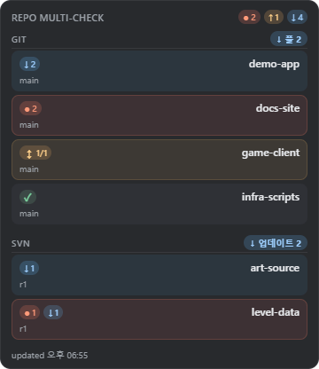
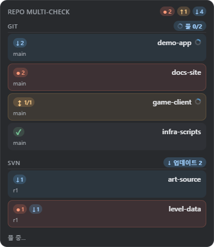
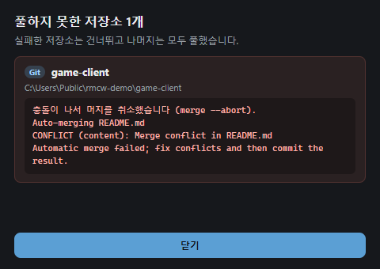
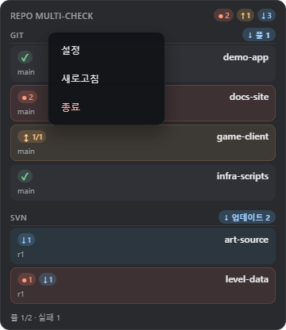
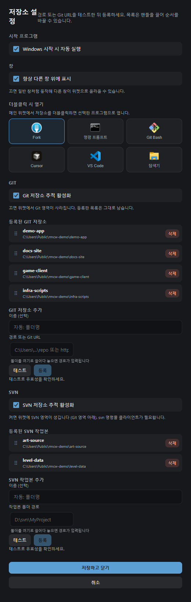

# Repo Multi-Check Widget

Windows 바탕화면용 위젯 — 여러 Git·SVN 저장소의 **브랜치·변경·동기화 상태**를 한눈에 확인하고, 밀린 커밋은 버튼 하나로 받습니다.

## 실행

- **일반:** 프로젝트 폴더의 `시작.bat` 더블클릭 → `%LOCALAPPDATA%\RepoMultiCheckWidget\` 설치본 실행
- **개발:** `npm install` 후 `npm run tauri dev`

> 예전 이름은 `git-multi-check-widget`입니다. 새 버전을 처음 실행하면 등록한 저장소 목록(`%LOCALAPPDATA%\GitMultiCheckWidget\repos.json`), 위젯 위치, 시작 프로그램 등록을 새 이름으로 옮겨 씁니다. 옛 폴더는 그대로 남으니 확인 뒤 지워도 됩니다.

## 화면과 사용법

### 위젯



- 등록한 저장소가 한 줄씩 **이름 · 현재 브랜치 · 상태 아이콘** 순으로 표시됩니다
- `Git` / `SVN` 영역마다 제목줄이 있고, 받을 커밋이 있으면 제목줄 오른쪽에 **빠른 풀** 버튼이 뜹니다 ([아래](#빠른-풀))
- 헤더 오른쪽은 전체 요약 — 몇 **개**의 저장소가 각 상태인지 세어 보여줍니다
- 맨 아래는 마지막 갱신 시각
- 창은 빈 곳을 끌어 옮기며, 위치는 다음 실행 때 복원됩니다
- 시작 직후에는 로컬 상태만 먼저 읽고, 이후 **5분마다 `git fetch`** 한 뒤 다시 계산합니다. SVN은 로컬에 서버 상태가 남지 않아, 작업본마다 처음 한 번은 서버에 묻고 그 뒤에는 마지막 답을 이어 씁니다

| 아이콘 | 뜻 |
|---|---|
| `●` N | 커밋하지 않은 로컬 변경 N건 |
| `↑` N | 로컬 커밋 N개가 아직 push되지 않음 |
| `↓` N | 원격 커밋 N개를 아직 pull하지 않음 |
| `↕` N/M | 양쪽이 갈라짐 (ahead N / behind M) |
| `✓` | 원격과 동기화됨 |
| `—` | upstream 브랜치 없음 |
| `…` | 상태 확인 중 |
| `!` | 조회 실패 — 마우스를 올리면 원인 표시 |

`●`는 동기화 아이콘과 함께 붙습니다. `● 2 ↑ 1` 은 "변경 2건 + push할 커밋 1개"라는 뜻입니다.

### 빠른 풀



- 영역에 받을 커밋이 있는 저장소(`↓` 또는 `↕`)가 하나라도 있으면, 그 영역 제목줄 오른쪽에 `↓ 풀 N` (SVN은 `↓ 업데이트 N`) 버튼이 뜹니다. Git·SVN 버튼은 동시에 뜰 수 있습니다
- 누르면 그 저장소들을 위에서부터 하나씩 받습니다. 진행 중에는 버튼에 `풀 2/4`처럼 진행률이 표시됩니다
  - **Git** — `fetch` 후 fast-forward를 먼저 시도하고, 갈라졌으면 merge합니다. 충돌이 나면 `merge --abort`로 되돌리고 다음 저장소로 넘어갑니다. 덮어쓸 로컬 변경 때문에 받을 수 없으면 손대지 않고 건너뜁니다. 진행 중인 merge·rebase가 있는 저장소도 건너뜁니다. Unity 등이 파일을 잡고 있어 도중에 멈추면, 그때까지 바뀐 파일을 되돌려 원래 상태로 둡니다
  - **SVN** — 작업본마다 `svn update --accept postpone`. 실패하면 건너뜁니다. SVN에는 되돌리기가 없어 충돌은 작업본에 표시된 채로 남으니 TortoiseSVN으로 해결하세요. 10분 동안 아무 진행이 없으면 멈춘 것으로 보고 끝냅니다 (작업본이 잠기면 TortoiseSVN의 Clean up)
- 다 끝나면 받은 저장소들을 다시 읽어 갱신합니다. **실패한 저장소가 있을 때만** 이름과 메시지를 모은 팝업이 뜹니다



- 팝업을 열어 둔 채 다시 풀하면 이번에 받아진 저장소는 목록에서 빠지고, 남은 실패가 없으면 팝업이 저절로 닫힙니다
- 풀하는 동안 **그 영역**의 새로고침은 미뤘다가 풀이 끝나면 한 번 돌고, 다른 영역은 그대로 새로고침됩니다

### 우클릭 메뉴



- **빈 영역** 우클릭 → `설정` (별도 창) / `새로고침` (전체 재조회) / `종료`
- **저장소 줄** 우클릭 → `열기` / `이 레포만 최신화` / `탐색기에서 열기`

### 설정 창



- **시작 프로그램** — Windows 시작 시 자동 실행. 개발 빌드에서는 잠기고, `시작.bat`으로 설치한 릴리스에서만 켤 수 있습니다
- **창** — 「항상 다른 창 위에 표시」. 토글하면 즉시 반영되고, 저장하지 않고 닫으면 되돌아갑니다. 끄면 일반 창처럼 다른 창이 위젯 위로 올라옵니다
- **더블클릭 시 열기** — 저장소 줄의 `열기`가 사용할 프로그램: Fork / 명령 프롬프트 / Git Bash / Cursor / VS Code / 탐색기
- **Git** — 「Git 저장소 추적 활성화」. 끄면 위젯에서 Git 영역이 사라지고 스캔도 하지 않습니다. 등록 목록은 남아 있다가 다시 켜면 돌아옵니다
  - **등록된 Git 저장소** — 핸들(`⋮⋮`)을 끌어 순서를 바꾸고, 「삭제」로 뺍니다
  - **Git 저장소 추가** — 로컬 경로나 Git URL을 넣고 「테스트」로 확인한 뒤 「등록」. 폴더를 입력칸에 끌어다 놓아도 경로가 채워집니다
- **SVN** — 「SVN 저장소 추적 활성화」. 켜면 위젯에 SVN 영역이 생기고 SVN 작업본 목록을 관리합니다. `svn` 명령줄 클라이언트가 필요합니다
- Git·SVN을 둘 다 끄면 위젯에는 안내 문구만 남습니다

변경은 「저장하고 닫기」로 반영하고, 「취소」로 버립니다.

### 트레이 아이콘

위젯은 작업 표시줄에 단추가 없는 대신 알림 영역(트레이)에 아이콘이 뜹니다.

- **왼쪽 클릭**: 위젯 보이기/숨기기
- **오른쪽 클릭**: `위젯 보이기` / `위젯 숨기기` / `설정` / `종료`

Windows 10은 새 트레이 아이콘을 `^` 숨김 영역에 넣습니다. 늘 보이게 하려면 아이콘을 작업 표시줄로 한 번 끌어 두세요.

## 형제 프로젝트

- `cursor-usage-widget` — 같은 Tauri 2 + Vite 스택의 데스크톱 위젯

## Open Source Assets / Credits

| Asset | Author | Source | License |
|-------|--------|--------|---------|
| **Git Icon** (앱 아이콘) | Papirus Dev Team | [IconArchive — Papirus Apps Icons](https://www.iconarchive.com/show/papirus-apps-icons-by-papirus-team.html) | [GNU GPLv3](https://www.gnu.org/licenses/gpl-3.0.html) |

- 원본 PNG: `docs/assets/git-icon-papirus-source.png`
- 빌드용 아이콘: `app-icon.png`, `src-tauri/icons/` (스크립트 `npm run make:icon`으로 생성)

**라이선스 구분:** 위 아이콘 에셋만 GPLv3가 적용됩니다. 본 저장소의 애플리케이션 소스코드 라이선스와는 별개이며, 자세한 고지는 [`LICENSE-THIRD-PARTY.md`](LICENSE-THIRD-PARTY.md)를 참고하세요.

## 아이콘 재생성

```powershell
npm run make:icon
npm run build:app
```

`app-icon.png`를 교체한 뒤 위 명령을 실행하면 `src-tauri/icons/`가 갱신됩니다.
